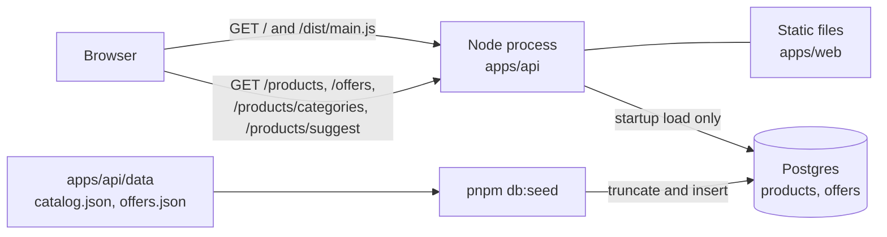
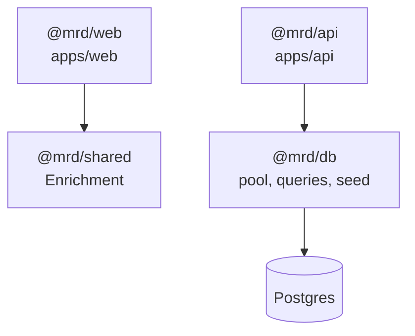
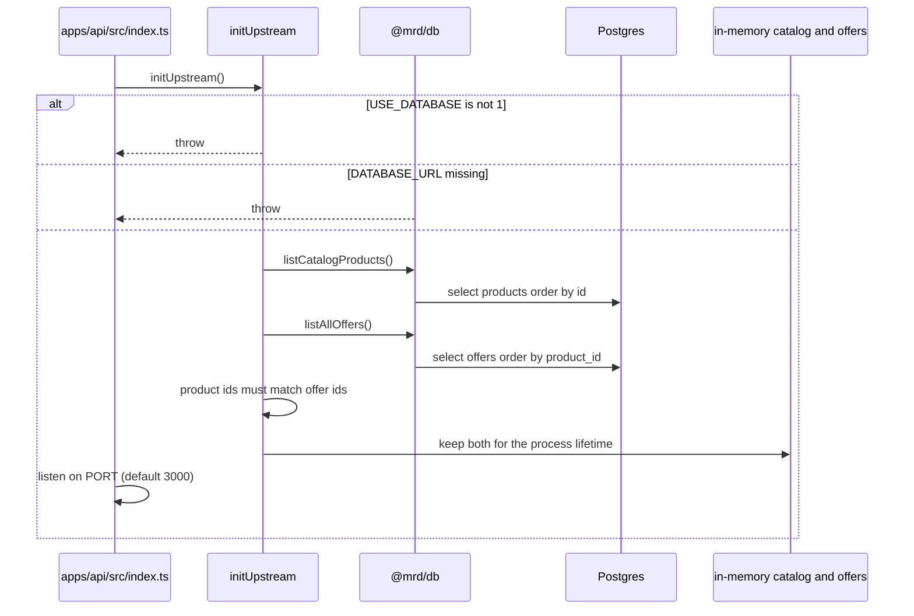
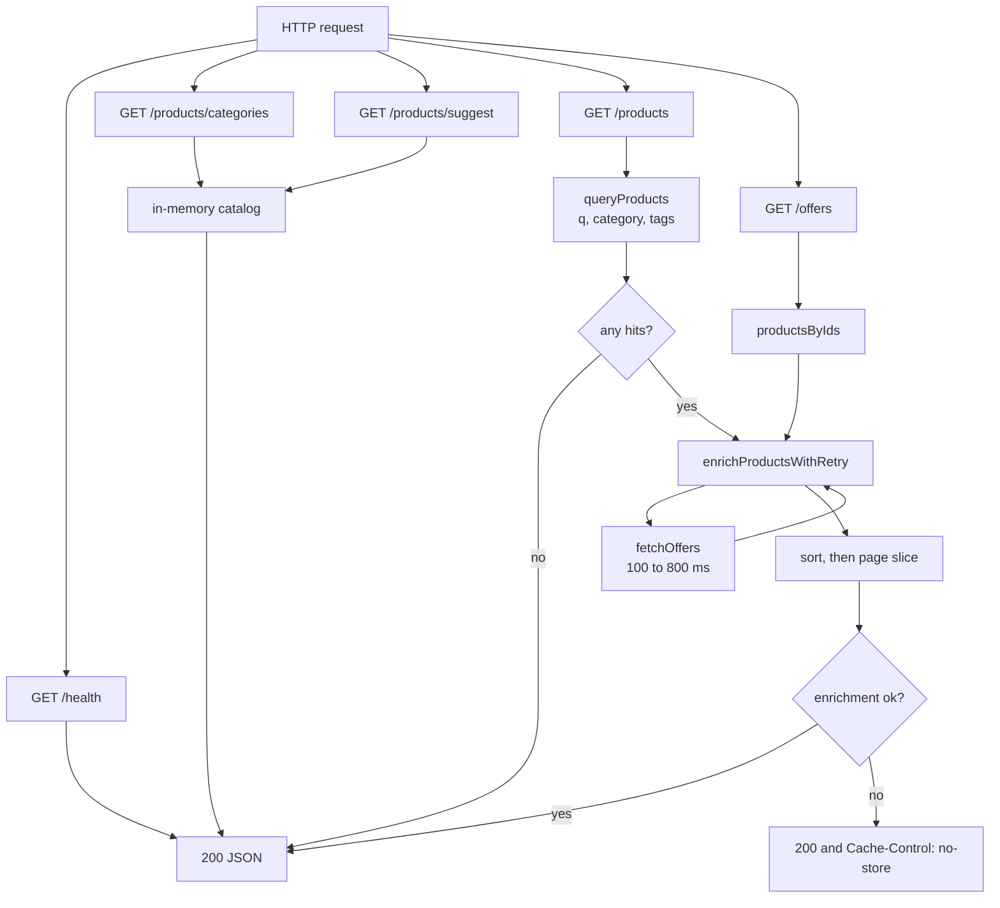
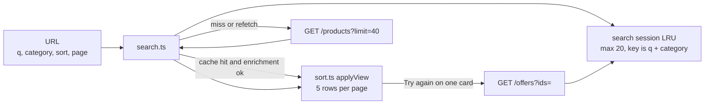
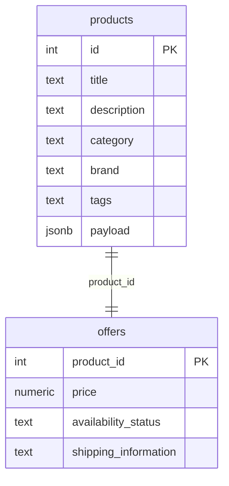

# Architecture

One Node process serves the page and the JSON API. Postgres holds the catalog. After startup, search and suggestions run against an in-memory copy. Price and availability come from an in-process simulator, not from another HTTP service.

Behaviour and trade-offs are in [SOLUTION.md](SOLUTION.md). How to run it is in [README.md](README.md).

## System

The browser never opens a database connection. `fetchOffers` never leaves the process. JSON files are read by the seed script, not by request handlers.

## Packages

`@mrd/api` does not import `@mrd/shared`. The API declares its own `Enrichment` union in [`apps/api/src/enrich.ts`](apps/api/src/enrich.ts). The page re-exports the same union from [`packages/shared/src/index.ts`](packages/shared/src/index.ts).

## Startup

Express ([`apps/api/src/app.ts`](apps/api/src/app.ts)) mounts JSON parsing, static files from `apps/web`, then [`productsRouter`](apps/api/src/routes/products.ts). Compiled code lives in `apps/api/dist`; `../../web` from that directory is `apps/web`, which serves `index.html` and `dist/main.js`.

A reseed is invisible until the process starts again. Search does not query Postgres per request.

## Request paths

Cheap reads stay on the snapshot. Search and per-card retry pay the simulator.

`fetchOffers` ([`apps/api/src/upstream.ts`](apps/api/src/upstream.ts)) waits, throws about one time in five (`upstream offers failed`), and on success can drop individual ids (about 15%). [`enrichProductsWithRetry`](apps/api/src/enrich.ts) retries the whole batch on a throw, and missing ids only on a partial result, until **3 attempts or 2.5s** (`ENRICH_MAX_ATTEMPTS`, `ENRICH_MAX_MS`). The HTTP status stays `200`. `enrichment` is `ok`, `partial`, or `failed`.

`GET /products` enriches the full match set, sorts by price, then returns at most `limit` rows (max **40**). `total` is the full hit count.

## Page

The page is compiled TypeScript with no bundler: [`apps/web/src/main.ts`](apps/web/src/main.ts) → `apps/web/dist/main.js`.

Sort and Previous/Next do not call the API again. They rewrite the URL and re-render the session. A filter change resets to page 1 and fetches. Only sessions whose merged rows are fully enriched are stored. Suggest titles sit in a separate in-memory map and abort the previous request.

A bare `/` leaves the list empty. A URL with `q`, `category`, `sort`, or `page` restores the form and runs search. Unknown query keys are dropped. `category` must match a name from `GET /products/categories`.

## Data

Schema: [`supabase/migrations/20260322220000_products_offers.sql`](supabase/migrations/20260322220000_products_offers.sql). Seed maps `catalog.json` into `products` (search fields as columns, the rest in `payload`) and `offers.json` into `offers`. Runtime `listCatalogProducts` selects the search columns only, not `payload`.

## Tests and the database

API tests mock `@mrd/db` with the JSON files ([`apps/api/vitest.setup.ts`](apps/api/vitest.setup.ts)), then call `initUpstream`. CI does not start Postgres. Web tests exercise URL parsing, sort, merge, enrichment, and the session cache without a server. `@mrd/db` tests mock the pool.

## Outside this process

These are not part of the running architecture. They are tracked in [TODO.md](TODO.md): Redis, HTTP cache headers on static files, a real HTTP offers upstream, rate limits, helmet, and graceful shutdown. The simulator’s fail rates are constants in `upstream.ts`, not environment variables.
