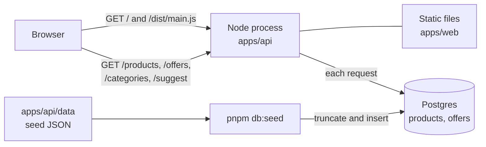
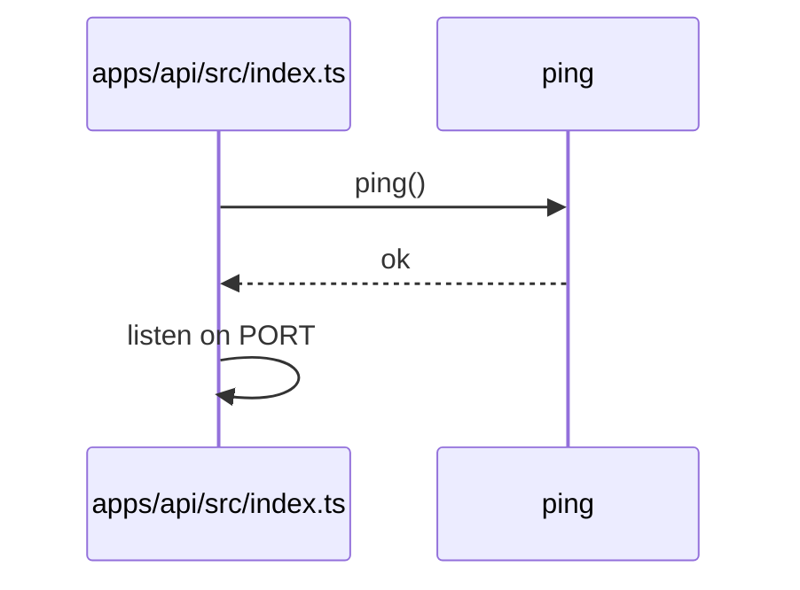
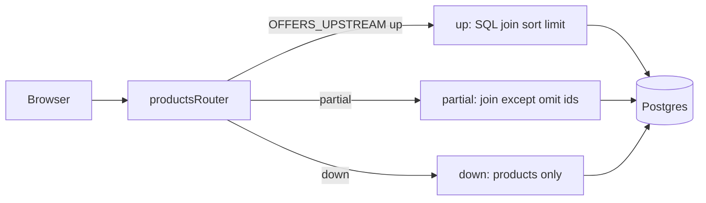

# Architecture

One Node process serves the page and the JSON API. Postgres holds the catalog. Each request runs parameterized SQL; nothing loads the full catalog into the process.

Behaviour and trade-offs are in [SOLUTION.md](SOLUTION.md). How to run it is in [README.md](README.md).

## System

## Startup

Requires `USE_DATABASE=1` and `DATABASE_URL`.

## Search and offers

`OFFERS_OMIT_IDS` overrides the default even-id omit list in `partial` mode.

## Page

Browser session LRU unchanged. Suggest uses a separate in-memory map on the client.

## Data

`products` and `offers` tables; categories are `products.category` (distinct query, no `categories` table).

Seed source: [`apps/api/data/catalog.json`](apps/api/data/catalog.json) (catalog fields) and [`apps/api/data/offers.json`](apps/api/data/offers.json) (pricing). Runtime never reads those files. After changing seed JSON (including the split that moved pricing out of catalog), run **`pnpm db:seed`** to truncate and reload Postgres. Legacy catalog rows with inline pricing are still accepted at seed time; see README **Seed data layout and migration**.

## Tests

API tests mock `@mrd/db`. CI does not run Postgres.
