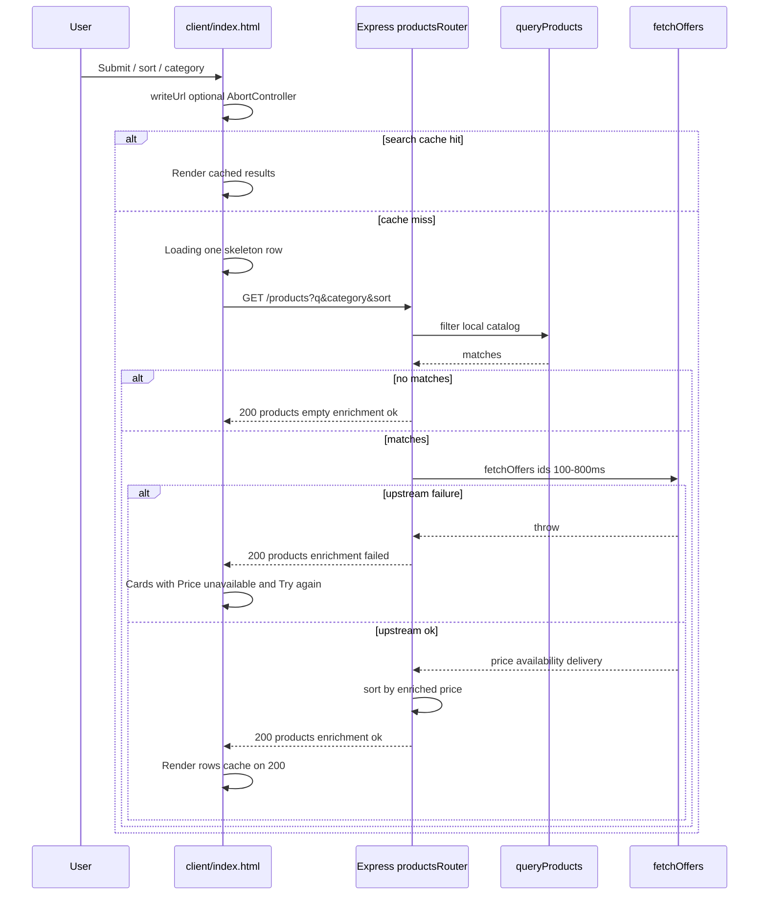

# Solution

This note explains how the product search app works: the HTTP API, the simulated upstream, the static page in `client/`, and the main design choices.

## Main flow

One Node process serves the static UI and the JSON API. A typical product search (after the user submits or changes a filter) looks like this:

Categories and suggest read the in-memory catalog without calling `fetchOffers`. Only `GET /products` pays the simulated upstream delay and failure rate, and only when the local search has at least one hit.

## HTTP API

Express serves JSON under the same origin as the UI (`src/app.ts` mounts static `client/` and `productsRouter`).

### `GET /products`

Main search endpoint. The route filters the in-memory catalog first, then calls `fetchOffers` for the matching ids.

Query parameters:

- `q` — free text. Matched case-insensitively as a substring against title, description, category, and brand. Blank means no text filter.
- `category` — single category. Trimmed and compared case-insensitively. Blank means no category filter.
- `sort` — `asc` or `desc`. Applied to the enriched price. Anything other than `desc` (including missing) sorts low to high. If enrichment fails, there is no price to sort on, so the hits stay in catalog order.

Response: `{ products, total, query, enrichment }`. `enrichment` is `"ok"` or `"failed"`.

On `"ok"`, each product is the catalog object plus `price`, `availabilityStatus`, and `shippingInformation` from the upstream. On `"failed"`, those three fields are removed and the catalog fields remain. An empty match list does not call the upstream and returns `enrichment: "ok"`.

The route logs each search to the server terminal, for example `search #3 200 412ms enrichment=ok q="cream"`. A failed offer lookup is still status `200`, with `enrichment=failed` in that line.

### `GET /products/categories`

Returns `{ categories }` — sorted unique category names from the in-memory catalog. Used to build category chips on the page. Does not call `fetchOffers`.

### `GET /products/suggest`

Type-ahead helper. Query: `q` (prefix-style match using the same field rules as search) and optional `limit` (default 8, capped at 20).

Response: `{ suggestions }` — unique product titles, catalog order, up to the limit.

Reads the catalog synchronously; **does not** call `fetchOffers`, so suggestions stay fast while product search still pays upstream latency.

### `GET /health`

Returns `{ status: "ok", timestamp }` where `timestamp` is the server time in ISO 8601 (UTC). Used in tests and manual checks (`api-tester/health.http`).

## Catalog and upstream

The catalog is a local JSON file of 40 items in `data/catalog.json`, copied from the [DummyJSON](https://dummyjson.com/products) products resource. Search uses that file directly. At startup the process also builds an in-memory offer map from each item’s `id`, `price`, `availabilityStatus`, and `shippingInformation`.

`fetchOffers` is that simulated upstream. It is an in-process function, not a second HTTP service. It waits 100–800 ms and throws about one time in five (`upstream offers failed`). One call covers every id in the result set. The route then joins offers back onto the matches by `id`. The cost of that single call is under Trade-offs.

Search logic lives in pure functions in `src/search.ts` (filter, category, price sort, suggest titles) so Vitest can test without HTTP.

## Tests

Vitest covers search, category filter, and both price orders directly in `search.test.ts`. `upstream.test.ts` checks that `fetchOffers` returns price and availability, and that it throws when the random check falls in the first fifth. Supertest hits the products router with a mocked `fetchOffers` (`routes/products.test.ts`): enriched price, sort by that price, a failed enrich that still returns hits without price, categories, and suggest without calling `fetchOffers`. `GET /health` is exercised once through the real app in `app.test.ts`. The page was also checked by hand on a phone. The local server was exposed with ngrok, and the layout was opened on a mobile device: search on top, category chips in the middle, and the sort select at the bottom. From 40rem the chips sit on the left and the sort select on the right.

## Tooling

TypeScript strict mode is on. Scripts: `pnpm dev` (tsx watch), `pnpm test`, `pnpm build`, `pnpm start`. `PORT` defaults to `3000`; `.env.example` documents it. The app does not load a `.env` file at runtime.

Manual requests live in `api-tester/` (`health.http`, `search.http`) for the REST Client extension.

## Page

`client/index.html` and `client/styles.css` are static assets. Behaviour is a single module script: no bundler, no framework. Rows and panels come from `<template>` elements (`#result`, `#skeleton`, `#search-error`).

### Initial load

1. The form is synced from the URL (`q`, `category`, `sort=desc` when present).
2. `GET /products/categories` fills category radio chips (with a Clear control).
3. If the URL has a query string, `search()` runs once **without** pushing another history entry.
4. If the URL is bare `/`, the results list stays **empty** — there is no automatic search with an empty `q`.

### Search and filters

Submitting the form, changing sort, or selecting a category runs `search()`. Parameters sent to `GET /products` are the current text, selected category (if any), and sort (`asc` / `desc`).

Category chips are radios built from the categories endpoint. Clear unchecks the selection so the next request omits the category filter.

Sort labels on the page are “Price: low to high” and “Price: high to low” — one sort dimension (price), two directions, which matches the brief.

### Loading, results, and errors

- **Loading:** summary “Loading…”, **one** skeleton row (same height as a result card to limit layout shift), `aria-busy` on the list.
- **Success:** summary “N results”, list filled by cloning `#result`. Category in small capitals above the title, then brand, a ZAR price (`Intl.NumberFormat`), delivery line from `shippingInformation`, and a badge from `availabilityStatus` (`Available` / `Only a few left`; low stock removes the delivery row). Search and clock icons are inline SVGs (no third-party icon script).
- **Enrichment failed:** same list of hits. Each card shows “Price unavailable” and a secondary Try again button, which calls `search()` again. Availability and delivery are omitted. This response is not cached.
- **Network error:** list cleared; `#search-error` cloned into `.results__status` with Try again → `search()`. Aborted requests (`AbortController`) do not show the error panel.

A new search clears the status area before showing the skeleton. When the browser goes back online, search retries only if the error panel is visible.

### Stretch behaviour on the page

- **URL sync:** User-initiated searches update the address bar with `history.pushState` (`q`, `category`, `sort=desc` when set). Back/Forward restores the form and re-runs or clears results. Shared links restore state.
- **Type-ahead:** Debounced input calls `GET /products/suggest`; prior suggest requests are aborted; titles are cached in a small in-memory map.
- **Client cache:** Product responses with `enrichment: "ok"` are keyed by full query string (max 20 entries, LRU-style touch). An enrichment failure and a network error are not cached, so Try again calls the upstream again. Cache hits log `search cache hit` in the browser console.
- **Instrumentation:** Browser console logs `search {status} {ms}ms` per fetch; server logs as above in the `pnpm dev` terminal.

## Trade-offs

**A failed offer lookup still returns the hits.** `GET /products` responds `200` with `enrichment: "failed"`. Price, availability, and delivery are omitted, and each card shows “Price unavailable” and Try again. The product names stay on screen, which matches showing those fields when the upstream has them. The status code itself stays `200`, so the failure shows up in `enrichment` and in the server log (`enrichment=failed`). That response is not cached, so Try again calls `fetchOffers` again.

**One upstream call covers the whole result set.** `fetchOffers` loads price, availability, and delivery for every matching id together. One failure drops those three fields on every row. The page keeps one loading state and one retry. A per-row provider could leave some cards priced and others not, with a separate retry on each.

**Price is the only sort.** The brief asks for one sort, and gives popularity or price as the examples. The API and the select order by the enriched price, low to high or high to low. There is no popularity order. When enrichment fails there is no price, so the hits stay in catalog order.

## Design decisions (summary)

| Topic                | Choice                                             | Why                                                                |
| -------------------- | -------------------------------------------------- | ------------------------------------------------------------------ |
| Upstream             | In-process `fetchOffers`, delay and random failure | Live price and availability without a second service               |
| Failed enrichment    | `200` with hits, commercial fields omitted         | Names stay on screen; each card can retry                          |
| Suggest / categories | No `fetchOffers`                                   | Fast chips and dropdown; only product search pays upstream latency |
| UI stack             | HTML templates + DOM script                        | Small surface area for the assignment; easy to run                 |
| Concurrency          | `AbortController` on search and suggest            | Avoid stale results when the user types or changes filters quickly |
| Skeleton count       | One row                                            | Reduces CLS when a query returns few cards                         |
| Sort                 | Price only                                         | Meets “one sort” while giving asc/desc in the UI                   |

## AI assistance

Cursor Chat was used as a rubber-ducking tool while extending the page, helping me articulate my reasoning and think through implementation challenges, particularly when working with Express.js, which I hadn't used in several years.

AI was also used to review my code for potential issues and areas for improvement, and to assist with documenting the project.
