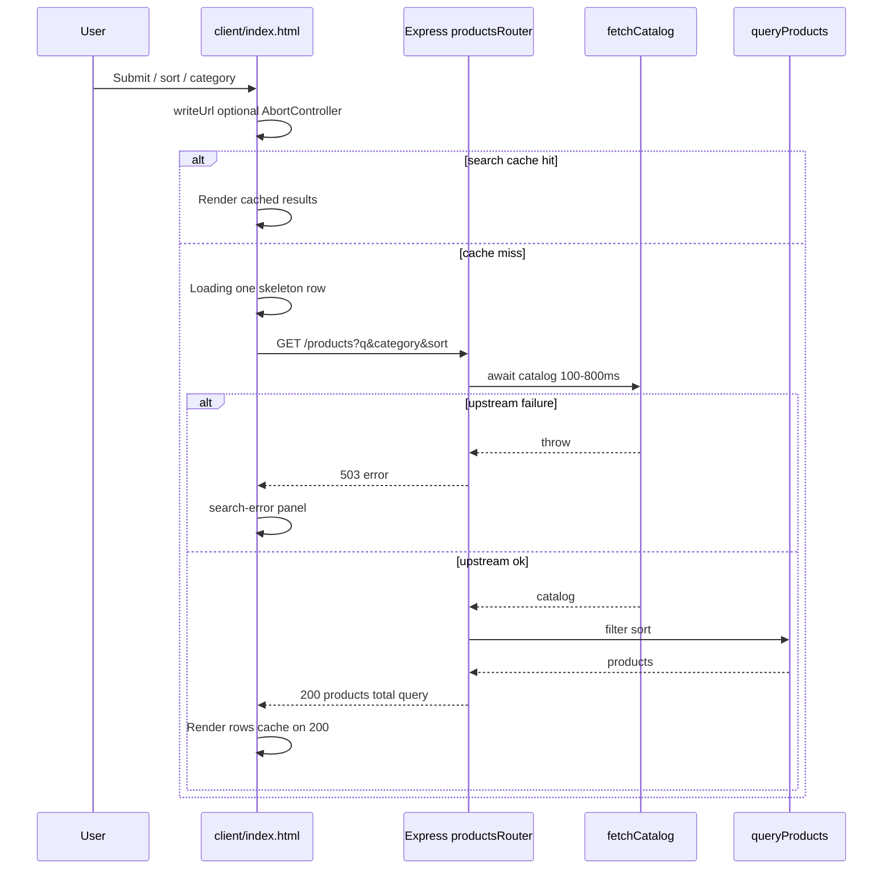

# Solution

This note explains how the product search app works: the HTTP API, the simulated upstream, the static page in `client/`, and the main design choices.

## Main flow

One Node process serves the static UI and the JSON API. A typical product search (after the user submits or changes a filter) looks like this:

Categories and suggest read the in-memory catalog without calling `fetchCatalog`; only `GET /products` pays the simulated upstream delay and failure rate.

## HTTP API

Express serves JSON under the same origin as the UI (`src/app.ts` mounts static `client/` and `productsRouter`).

### `GET /products`

Main search endpoint. Every call waits on the simulated upstream (`fetchCatalog`) before filtering.

Query parameters:

- `q` — free text. Matched case-insensitively as a substring against title, description, category, and brand. Blank means no text filter.
- `category` — single category. Trimmed and compared case-insensitively. Blank means no category filter.
- `sort` — `asc` or `desc`. Results are always ordered by price. Anything other than `desc` (including missing) sorts low to high.

Response on success: `{ products, total, query }`. Each element is the full catalog object (e.g. `price`, `availabilityStatus`, `shippingInformation`, `brand`).

On upstream failure: `503` with `{ error: "upstream catalog failed" }` and no product list.

The route logs each search to the server terminal, for example `search #3 200 412ms q="cream"`.

### `GET /products/categories`

Returns `{ categories }` — sorted unique category names from the in-memory catalog. Used to build category chips on the page. Does not call `fetchCatalog`.

### `GET /products/suggest`

Type-ahead helper. Query: `q` (prefix-style match using the same field rules as search) and optional `limit` (default 8, capped at 20).

Response: `{ suggestions }` — unique product titles, catalog order, up to the limit.

Reads the catalog synchronously; **does not** call `fetchCatalog`, so suggestions stay fast while product search still pays upstream latency.

### `GET /health`

Returns `{ status: "ok", timestamp }` where `timestamp` is the server time in ISO 8601 (UTC). Used in tests and manual checks (`api-tester/health.http`).

## Catalog and upstream

The catalog is a local JSON file of 40 items in `data/catalog.json`, copied from the [DummyJSON](https://dummyjson.com/products) products resource. The upstream is an in-process function, not a second HTTP service. It waits 100–800 ms at random and fails about one time in five, then returns the same parsed catalog loaded at startup.

Price, availability, and delivery text already live on each item, so search does not fetch per product after the catalog arrives.

**Trade-off:** In production you might call a provider per row and tolerate partial data. Here one upstream failure fails the whole `GET /products` response so the UI can show a single error state instead of a mix of complete and incomplete rows.

Search logic lives in pure functions in `src/search.ts` (filter, category, price sort, suggest titles) so Vitest can test without HTTP.

## Tests

Vitest covers search, category filter, both price orders, and suggest behaviour directly in `search.test.ts`. `upstream.test.ts` checks delay bounds and the failure path. Supertest hits the products router with a mocked upstream (`routes/products.test.ts`): happy path, `503`, categories, and suggest without calling `fetchCatalog`. `GET /health` is exercised once through the real app in `app.test.ts`. The page was also checked by hand on a phone. The local server was exposed with ngrok, and the layout was opened on a mobile device: search on top, category chips in the middle, and the sort select at the bottom. From 40rem the chips sit on the left and the sort select on the right.

## Tooling

TypeScript strict mode is on. Scripts: `pnpm dev` (tsx watch), `pnpm test`, `pnpm build`, `pnpm start`. `PORT` defaults to `3000`; `.env.example` documents it. The app does not load a `.env` file at runtime.

Manual requests live in `api-tester/` (`health.http`, `search.http`) for the REST Client extension.

## Page

`client/index.html` and `client/styles.css` are static assets. Behaviour is a single module script: no bundler, no framework. Rows and panels come from `<template>` elements (`#result`, `#skeleton`, `#search-error`).

### Initial load

1. The form is synced from the URL (`q`, `category`, `sort=desc` when present).
2. `GET /products/categories` fills category radio chips (with a Clear control).
3. If the URL has a query string, `search()` runs once **without** pushing another history entry.
4. If the URL is bare `/`, the results list stays **empty** — there is no automatic search with an empty `q`.

### Search and filters

Submitting the form, changing sort, or selecting a category runs `search()`. Parameters sent to `GET /products` are the current text, selected category (if any), and sort (`asc` / `desc`).

Category chips are radios built from the categories endpoint. Clear unchecks the selection so the next request omits the category filter.

Sort labels on the page are “Price: low to high” and “Price: high to low” — one sort dimension (price), two directions, which matches the brief.

### Loading, results, and errors

- **Loading:** summary “Loading…”, **one** skeleton row (same height as a result card to limit layout shift), `aria-busy` on the list.
- **Success:** summary “N results”, list filled by cloning `#result`. Title, brand, ZAR price (`Intl.NumberFormat`, `en-ZA`), delivery line from `shippingInformation`, badge from `availabilityStatus` (`Available` / `Only a few left`; low stock removes the delivery row). Search and clock icons are inline SVGs (no third-party icon script).
- **503 or network error:** list cleared; `#search-error` cloned into `.results__status` with Try again → `search()`. Aborted requests (`AbortController`) do not show the error panel.

A new search clears the status area before showing the skeleton. When the browser goes back online, search retries only if the error panel is visible.

### Stretch behaviour on the page

- **URL sync:** User-initiated searches update the address bar with `history.pushState` (`q`, `category`, `sort=desc` when set). Back/Forward restores the form and re-runs or clears results. Shared links restore state.
- **Type-ahead:** Debounced input calls `GET /products/suggest`; prior suggest requests are aborted; titles are cached in a small in-memory map.
- **Client cache:** Successful product responses are keyed by full query string (max 20 entries, LRU-style touch). Failures are not cached. Cache hits log `search cache hit` in the browser console.
- **Instrumentation:** Browser console logs `search {status} {ms}ms` per fetch; server logs as above in the `pnpm dev` terminal.

## Design decisions (summary)

| Topic                | Choice                                  | Why                                                                |
| -------------------- | --------------------------------------- | ------------------------------------------------------------------ |
| Upstream             | In-process delay + random failure       | Demonstrates slow load and 503 without extra infrastructure        |
| Failed search        | Whole request 503                       | One error UI                                                       |
| Suggest / categories | No `fetchCatalog`                       | Fast chips and dropdown; search still models slow catalog fetch    |
| UI stack             | HTML templates + DOM script             | Small surface area for the assignment; easy to run                 |
| Concurrency          | `AbortController` on search and suggest | Avoid stale results when the user types or changes filters quickly |
| Skeleton count       | One row                                 | Reduces CLS when a query returns few cards                         |
| Sort                 | Price only                              | Meets “one sort” while giving asc/desc in the UI                   |

## AI assistance

Cursor Chat was used as a rubber-ducking tool while extending the page, helping me articulate my reasoning and think through implementation challenges, particularly when working with Express.js, which I hadn't used in several years.

AI was also used to review my code for potential issues and areas for improvement, and to assist with documenting the project.

