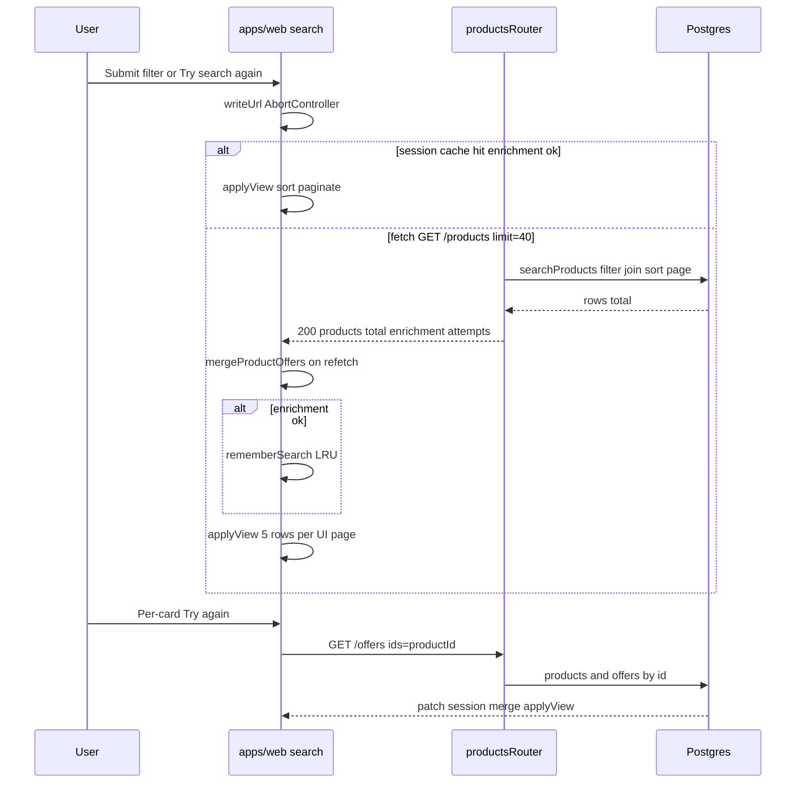

# Solution

This note explains how the product search app works: the HTTP API, Postgres queries, offer simulation, the static page in `apps/web/`, and the main design choices.

## Main flow

One Node process ([`apps/api`](apps/api)) serves the static UI and the JSON API. Each search hits Postgres; there is no catalog snapshot in memory.

Categories and suggest run their own SQL. Only product search joins `offers` (unless `OFFERS_UPSTREAM=down`).

## Layout

| Package       | Path              | Role                                        |
| ------------- | ----------------- | ------------------------------------------- |
| `@mrd/api`    | `apps/api`        | Express routes, offer mode env              |
| `@mrd/web`    | `apps/web`        | Static page; TypeScript compiled to `dist/` |
| `@mrd/shared` | `packages/shared` | Shared types (`Enrichment`)                 |
| `@mrd/db`     | `packages/db`     | Postgres pool, search SQL, seed script      |

## HTTP API

### `GET /products`

Main search endpoint. [`searchProducts`](packages/db/src/searchQueries.ts) filters with the same rules as [`searchableText`](apps/api/src/search.ts), optional category, `left join` on `offers` when upstream is `up` or `partial`, sorts by price (`nulls last`) or by `id` when `down`, and pages with `limit` max **40**. `total` comes from `count(*) over()`.

Query parameters: `q`, `category`, `sort`, `page`, `limit` — same semantics as before.

Response: `{ products, total, page, limit, query, enrichment, attempts }`. `attempts` is **1** when anything matched, **0** when empty. `Cache-Control: no-store` when `enrichment !== "ok"`.

### Offer simulation

`OFFERS_UPSTREAM` (default **`up`**):

- **`up`** — full join; missing offer row → null price on that product.
- **`partial`** — join skips a stable id set (even ids by default, or `OFFERS_OMIT_IDS`). Mixed prices → `enrichment: "partial"`.
- **`down`** — no join; names only, `enrichment: "failed"`.

Change env and restart to heal omitted ids; **Try again** does not bypass the omit list.

### `GET /offers`

`getCatalogProductsByIds` plus `fetchOffersByIds` for eligible ids (same omit rules as search in `partial` mode).

### `GET /products/categories`

`listCategories()` — `select distinct category from products`.

### `GET /products/suggest`

`suggestProductTitles` — same text match, unique titles in catalog id order, min 2 characters on `q`.

### `GET /health`

Unchanged.

## Catalog

Seed JSON under [`apps/api/data/`](apps/api/data/). Runtime reads Postgres only. Startup runs [`ping()`](packages/db/src/queries.ts), not a full catalog load.

## Tests

API router tests mock `@mrd/db`. CI does not start Postgres. Web and `@mrd/db` query unit tests unchanged in role.

## Page

Unchanged UX: `limit=40` fetch, in-memory sort/paging (5 rows), enrichment banners, session LRU, suggest debounce.

## Trade-offs

**Postgres per request** — Reseeds show up immediately; small catalog keeps latency low. Trigram indexes belong with a later typeahead task.

**Stable partial omit** — Sort order matches visible prices; not random per-request drops.

**500 on product query failure** — Distinct from offers-down, which still returns names.

## Design decisions (summary)

| Topic       | Choice                             | Why                                       |
| ----------- | ---------------------------------- | ----------------------------------------- |
| Catalog     | SQL search + join per request      | Production-shaped; no stale snapshot      |
| Offers down | Env switch, three modes            | Demo failed/partial UX without fake delay |
| Categories  | `products.category` column         | No extra table for chip names             |
| UI stack    | HTML templates + DOM in `apps/web` | Small surface area                        |

## AI assistance

Cursor Chat was used as a rubber-ducking tool while extending the page, helping me articulate my reasoning and think through implementation challenges, particularly when working with Express.js, which I hadn't used in several years.

AI was also used to review my code for potential issues and areas for improvement, and to assist with documenting the project.
