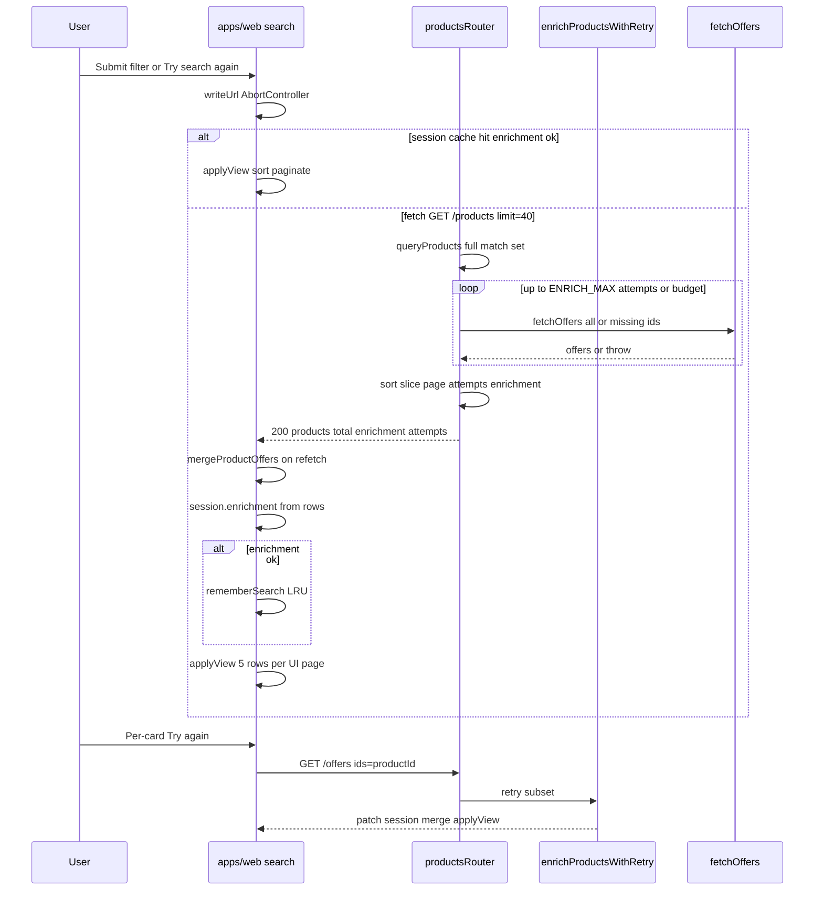

# Solution

This note explains how the product search app works: the HTTP API, Postgres-backed catalog, the simulated upstream, the static page in `apps/web/`, and the main design choices.

## Main flow

One Node process ([`apps/api`](apps/api)) serves the static UI and the JSON API. At startup [`initUpstream`](apps/api/src/upstream.ts) loads the catalog and offers from Postgres into memory. A typical product search (after the user submits or changes a filter) looks like this:

Categories and suggest read the in-memory catalog without calling `fetchOffers`. Only `GET /products` and `GET /offers` pay the simulated upstream delay and failure rate, and product search pays it only when the local search has at least one hit.

## Layout

| Package       | Path              | Role                                              |
| ------------- | ----------------- | ------------------------------------------------- |
| `@mrd/api`    | `apps/api`        | Express API, enrichment, in-process upstream      |
| `@mrd/web`    | `apps/web`        | Static page; TypeScript compiled to `dist/`       |
| `@mrd/shared` | `packages/shared` | Shared types (`Enrichment`)                       |
| `@mrd/db`     | `packages/db`     | Postgres pool, parameterized queries, seed script |

Express ([`apps/api/src/app.ts`](apps/api/src/app.ts)) serves [`apps/web`](apps/web) and mounts `productsRouter`. Search logic is pure functions in [`apps/api/src/search.ts`](apps/api/src/search.ts).

## HTTP API

### `GET /products`

Main search endpoint. The route filters the in-memory catalog first, then enriches matches via [`enrichProductsWithRetry`](apps/api/src/enrich.ts) (up to **3 attempts or 2.5s**).

Query parameters:

- `q` — free text. Matched case-insensitively as a substring against title, description, category, brand, and tags. Blank means no text filter.
- `category` — single category. Trimmed and compared case-insensitively. Blank means no category filter.
- `sort` — `asc` or `desc`. Applied to the enriched price. Anything other than `desc` (including missing) sorts low to high. If enrichment fails, there is no price to sort on, so the hits stay in catalog order.
- `page` — 1-based page (default `1`). Invalid values floor to `1`.
- `limit` — page size (default `10`, max `40`; higher values clamp to `40`).

The route enriches and sorts the **full** match set, then slices the window for the response. `total` is the full hit count; `products` holds at most `limit` items. Upstream still loads every matching id once per search so global price sort stays correct. The browser requests `limit=40` once per filter, so the UI session holds at most **40 enriched rows** even when `total` is larger (remaining hits are not loaded until a future pagination story).

Response: `{ products, total, page, limit, query, enrichment, attempts }`. `enrichment` is `"ok"`, `"partial"`, or `"failed"`. When `enrichment !== "ok"`, the response includes `Cache-Control: no-store`.

On `"ok"`, every product in the **full match set** is fully enriched. On `"partial"`, at least one row is still missing commercial fields after retries. On `"failed"`, no offers were obtained (e.g. every upstream attempt threw or returned nothing). An empty match list does not call the upstream and returns `enrichment: "ok"`.

Before responding, the server validates the joined list: wholesale upstream failures retry the batch; partial gaps retry **missing ids only**, until all rows are enriched or the attempt/time budget is exhausted.

The route logs each search to the server terminal, for example `search #3 200 890ms enrichment=ok attempts=2 q="cream"`. Responses are still status `200`; the log shows `enrichment` and `attempts`. Retry limits default to **3 attempts / 2500 ms** and are configurable with `ENRICH_MAX_ATTEMPTS` and `ENRICH_MAX_MS`.

### `GET /offers`

Query `ids` (comma-separated catalog ids). Runs the same enrichment retry helper for that subset only. Used by per-card **Try again** on the page (`GET /offers?ids=12`). Returns `{ products, enrichment, attempts }`. Missing `ids` is `400`.

### `GET /products/categories`

Returns `{ categories }` — sorted unique category names from the in-memory catalog. Used to build category chips on the page. Does not call `fetchOffers`.

### `GET /products/suggest`

Type-ahead helper. Query: `q` (prefix-style match using the same field rules as search) and optional `limit` (default 8, capped at 20).

Response: `{ suggestions }` — unique product titles, catalog order, up to the limit.

Reads the catalog synchronously; **does not** call `fetchOffers`, so suggestions stay fast while product search still pays upstream latency.

### `GET /health`

Returns `{ status: "ok", timestamp }` where `timestamp` is the server time in ISO 8601 (UTC). Used in tests and manual checks (`api-tester/health.http`).

## Catalog and upstream

The seed source is 40 items copied from the [DummyJSON](https://dummyjson.com/products) products resource, stored in [`apps/api/data/catalog.json`](apps/api/data/catalog.json). Commercial fields live in a mirrored [`apps/api/data/offers.json`](apps/api/data/offers.json) (`id`, `price`, `availabilityStatus`, `shippingInformation`).

`pnpm db:seed` ([`packages/db/scripts/seed.ts`](packages/db/scripts/seed.ts)) truncates `public.products` and `public.offers`, then inserts those files. The schema is [`supabase/migrations/20260322220000_products_offers.sql`](supabase/migrations/20260322220000_products_offers.sql). Queries in [`packages/db/src/queries.ts`](packages/db/src/queries.ts) are parameterized.

At startup the API requires `USE_DATABASE=1` and `DATABASE_URL`. [`initUpstream`](apps/api/src/upstream.ts) loads every product and offer through `@mrd/db`, throws if product ids and offer ids do not match, and keeps both in memory. Search, categories, suggestions, and `fetchOffers` use that memory. Request handling does not read the JSON files or query Postgres again.

`fetchOffers` is an in-process function, not a second HTTP service. It waits 100–800 ms, throws about one time in five for a wholesale failure (`upstream offers failed`), and on success can omit individual ids at random (per-offer failure, about 15%). The route may invoke it multiple times per search within the retry budget. The client **Try again** button still refetches after the server gives up.

## Tests

Vitest covers API search in [`apps/api/src/search.test.ts`](apps/api/src/search.test.ts), enrichment retry in [`apps/api/src/enrich.test.ts`](apps/api/src/enrich.test.ts), the products router in [`apps/api/src/routes/products.test.ts`](apps/api/src/routes/products.test.ts), `fetchOffers` in [`apps/api/src/upstream.test.ts`](apps/api/src/upstream.test.ts), and `GET /health` in [`apps/api/src/app.test.ts`](apps/api/src/app.test.ts). Those API tests mock `@mrd/db` with [`apps/api/data/`](apps/api/data/) ([`apps/api/vitest.setup.ts`](apps/api/vitest.setup.ts)), so CI does not need Postgres. Web unit tests live under [`apps/web/src/`](apps/web/src/) (sort, merge, enrichment, URL state, and [`searchSession.ts`](apps/web/src/searchSession.ts)). `@mrd/db` has its own query tests. The page was also checked by hand on a phone.

## Tooling

pnpm workspace and Turborepo. TypeScript strict mode is on for the API and the browser (`apps/web/src/` → `apps/web/dist/` via `tsc`, no bundler). Scripts: `pnpm dev` (web build, then API watch and web `tsc -w`), `pnpm build`, `pnpm test`, `pnpm typecheck`, `pnpm start`, `pnpm db:seed`, `pnpm db:ping`. `PORT` defaults to `3000`. [`.env.example`](.env.example) documents `PORT`, `ENRICH_MAX_ATTEMPTS`, `ENRICH_MAX_MS`, `USE_DATABASE`, and `DATABASE_URL`. The app does not load a `.env` file at runtime.

Manual requests live in `api-tester/` (`health.http`, `search.http`) for the REST Client extension.

## Page

[`apps/web/index.html`](apps/web/index.html) and [`apps/web/styles.css`](apps/web/styles.css) are static assets. Behaviour is compiled from [`apps/web/src/main.ts`](apps/web/src/main.ts) to `apps/web/dist/main.js` (ESM, no framework bundler). Rows and panels come from `<template>` elements (`#result`, `#skeleton`, `#search-error`).

### Initial load

1. The form is synced from the URL (`q`, `category`, `sort=desc`, `page` when present).
2. `GET /products/categories` fills category radio chips (with a Clear control).
3. If the URL has a query string, `search()` runs once **without** pushing another history entry.
4. If the URL is bare `/`, the results list stays **empty** — there is no automatic search with an empty `q`.

### Search and filters

Submitting the form or selecting a category runs `search()` and resets to page 1. The browser sends only `q`, `category`, and `limit=40` to `GET /products` (one upstream enrichment per filter). The enriched page window is kept in a session; **sort** and **UI paging** (5 rows per page via `DEFAULT_LIMIT` in [`apps/web/src/url.ts`](apps/web/src/url.ts)) run in [`apps/web/src/sort.ts`](apps/web/src/sort.ts) via `applyView()` without refetching. Changing sort or Previous/Next updates the URL and re-renders from session. Direct API clients can still pass `sort`, `page`, and `limit` for server-side behaviour.

After a refetch, `mergeProductOffers` preserves commercial fields from the prior session when the new response omits them; `session.enrichment` is **recomputed** from the merged rows (so a failed wholesale response plus merge can become `"ok"`). Only `"ok"` sessions are cached.

Category chips are radios built from the categories endpoint. Clear unchecks the selection so the next request omits the category filter.

Sort labels on the page are “Price: low to high” and “Price: high to low” — one sort dimension (price), two directions, which matches the brief.

### Loading, results, and errors

- **Loading:** summary “Loading…”, **one** skeleton row (same height as a result card to limit layout shift), `aria-busy` on the list.
- **Success:** summary “N results” (full hit count), optional pager “Showing X–Y of N” when `total > limit`, list filled by cloning `#result`. Category in small capitals above the title, then brand, a ZAR price (`Intl.NumberFormat`), delivery line from `shippingInformation`, and a badge from `availabilityStatus` (`Available` / `Only a few left`; low stock removes the delivery row). Search and clock icons are inline SVGs (no third-party icon script).
- **Partial / failed enrichment:** a banner explains missing prices and offers **Try search again** (refetch with merge). Each unpriced card shows “Price unavailable” and **Try again**, which calls `GET /offers?ids=` for that product id and merges into the session. Availability and delivery are omitted on unpriced cards. Non-ok sessions are not cached.
- **Network error:** list cleared; `#search-error` cloned into `.results__status` with Try again → `search()`. Aborted requests (`AbortController`) do not show the error panel.

A new search clears the status area before showing the skeleton. When the browser goes back online, search retries only if the error panel is visible.

### Stretch behaviour on the page

- **URL sync:** Shareable query keys are `q`, `category`, `sort`, and `page` only ([`apps/web/src/searchParams.ts`](apps/web/src/searchParams.ts)). On load and on Back/Forward, the client parses the query, drops unknown params, validates `category` against names from `GET /products/categories`, and normalizes `sort`/`page`. If the address bar differs from the canonical form, `history.replaceState` fixes it without a new history entry. After search, `page` is clamped to the last page for the current result total (UI page size 5). User-initiated updates use `pushState` when the URL changes.
- **Type-ahead:** Debounced input calls `GET /products/suggest`; prior suggest requests are aborted; titles are cached in a small in-memory map.
- **Client cache:** Only sessions whose merged rows are fully enriched (`enrichment === "ok"`) are keyed by `q` + `category` (max 20 entries, LRU-style touch). Sort and page are not part of the key. Partial, failed, and network errors are not cached. Cache hits log `search cache hit` in the browser console.
- **Instrumentation:** Browser console logs `search {status} {ms}ms` per fetch; server logs as above in the `pnpm dev` terminal.

## Trade-offs

**A failed offer lookup still returns the hits.** `GET /products` responds `200` with `enrichment: "failed"`. Price, availability, and delivery are omitted, and each card shows “Price unavailable” and Try again. The product names stay on screen, which matches showing those fields when the upstream has them. The status code itself stays `200`, so the failure shows up in `enrichment` and in the server log (`enrichment=failed`). That response is not cached, so Try again calls `fetchOffers` again.

**Bounded server retries before responding.** Configurable upstream attempts and time budget (defaults 3 / 2.5s) reduce partial/failed responses; latency can increase when retries run. After the budget, partial or failed results are returned and the browser may Try again (full refetch with merge, or per-card `/offers`).

**Catalog is loaded once.** Postgres is the source of truth, but search filters the snapshot taken at startup. A reseed is invisible until the API process restarts. That keeps search and suggestions off the database on each keystroke.

**Price is the only sort.** The brief asks for one sort, and gives popularity or price as the examples. The API and the select order by the enriched price, low to high or high to low. There is no popularity order. When enrichment fails there is no price, so the hits stay in catalog order.

## Design decisions (summary)

| Topic                | Choice                                             | Why                                                                 |
| -------------------- | -------------------------------------------------- | ------------------------------------------------------------------- |
| Catalog              | Postgres at startup, then in memory                | Seed JSON stays off the request path; search stays local after init |
| Upstream             | In-process `fetchOffers`, delay and random failure | Live price and availability without a second service                |
| Failed enrichment    | `200` with hits, commercial fields omitted         | Names stay on screen; each card can retry                           |
| Suggest / categories | No `fetchOffers`                                   | Fast chips and dropdown; only product search pays upstream latency  |
| UI stack             | HTML templates + DOM script in `apps/web`          | Small surface area for the assignment; easy to run                  |
| Concurrency          | `AbortController` on search and suggest            | Avoid stale results when the user types or changes filters quickly  |
| Skeleton count       | One row                                            | Reduces CLS when a query returns few cards                          |
| Sort                 | Price only                                         | Meets “one sort” while giving asc/desc in the UI                    |

## AI assistance

Cursor Chat was used as a rubber-ducking tool while extending the page, helping me articulate my reasoning and think through implementation challenges, particularly when working with Express.js, which I hadn't used in several years.

AI was also used to review my code for potential issues and areas for improvement, and to assist with documenting the project.
