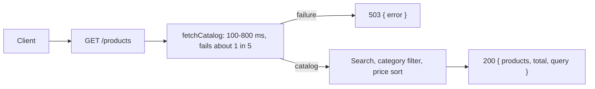

# Solution

This note covers the server. The UI section will be added once the page exists.

## Search API
`GET /products` is the only search endpoint. It takes three query parameters:

- `q` is free text. It is matched and matched without sensitivity against the title, description, category and brand. A blank value means no text filter.
- `category` keeps one category. The value is trimmed and compared without case sensitivity a blank value means no filter.
- `sort` is `asc` or `desc`. Results are always ordered by price. Anything other than `desc`, including a missing value, sort low to high.

The response is `{ products, total, query }`. Each product is the catalog object, so the UI can read `price`, `availabilityStatus` and `shippingInformation` from it.

## Catalog and upstream

The catalog is a local JSON file of 40 items, copied from the [DummyJSON](https://dummyjson.com/) products resource ([https://dummyjson.com/products](https://dummyjson.com/products)). The upstream provider is an in progress function not a second service. It reads that file waits 100-800 ms and fails about one time in five. Price, availability and delivery line already live on each catalog item, so the search does not make a second request per product. 

That is a deliberate shortcut. A real provider would be called after search, per item and a failure could leave some rows without a price. Here one failure fails the whole request. The route returns `503` with `{ error: "upstream catalog failed"}` and no product list. The UI can show one error state instead of a mix of priced and unpriced rows.

## Tests

Vitest covers the search, category filter and both price order directly. Supertest covers the route, including the `503` when the upstream rejects. A separate test checks the upstream delay and the failure path. `GET /health` is covered once, through the real app.

## Tooling

TypeScript strict mode is on. `pnpm dev`, `pnpm test`, `pnpm build` and `pnpm start` are the local scripts. `PORT` defaults to `3000`. `.env.example` documents it. The app does not load a `.env` file. `api-tester` holds the manual request (`health.http` and `search.http`) for the REST Client extension.